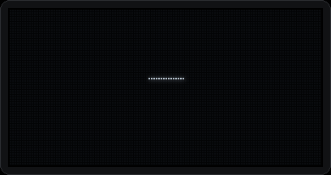

# TWOFOLD

A minimal 2-in / 2-out USB audio interface on the ESP32-S3: class-compliant UAC2 at 48 kHz / 24-bit plus USB-MIDI,
an onboard 32-bit float DSP chain, and a 128×64 OLED with one encoder. Radios are off by default ("Studio Mode").



| | |
|---|---|
| Audio | UAC2 async (explicit feedback), 48 kHz, 24-bit in 4-byte subslots, stereo in + out, driverless on Linux / macOS / Windows 10+ |
| DSP | 5-band parametric EQ → saturation (4× oversampled) → chorus/ensemble → stereo/ping-pong delay → plate reverb → bus compressor → monitor blend → volume → lookahead safety limiter → TPDF dither |
| Monitoring | zero-USB-latency direct monitor crossfade, dry or through the FX |
| Control | EC11 encoder (PCNT, accelerated), USB-MIDI CC (mappable), opt-in BLE-MIDI, opt-in WiFi web editor + OTA |
| Display | custom pixel fonts, live EQ curve from the real biquad coefficients + spectrum, per-effect visualisations, 60 fps tweened motion |
| Persistence | settings, MIDI map and 8 presets in NVS, written only in audio-safe windows |

Docs: [PLAN.md](PLAN.md) (architecture, clocking, budgets, every assumption and deviation) ·
[wiring](docs/wiring.md) · [clock analysis](docs/clocking/clock_jitter.md) · [DSP test results](docs/test-results/dsp_tests.md) ·
[UI design](docs/img/ui/) · [enclosure](docs/enclosure.md) · [web API](firmware/components/net/API.md) · [tools](tools/README.md)

---

## Hardware

### BOM
| qty | part | notes |
|---|---|---|
| 1 | Waveshare ESP32-S3-Zero (ESP32-S3FH4R2, 4 MB flash, 2 MB PSRAM) | native USB-C on GPIO19/20 |
| 1 | PCM5102A module ("GY-PCM5102", purple) | open its XSMT solder jumper (GPIO9 drives XSMT); FMT=L, FLT=L, DEMP=L |
| 1 | PCM1808 module | FMT=0 (I2S). MD1=MD0=0 (slave) in internal clock mode; MD1=MD0=1 (master 256fs) in low-jitter mode |
| 1 | 0.96" 128×64 I2C OLED (SSD1306 or SH1106, 4-pin, 0x3C) | controller selectable in Kconfig and at runtime (Settings → OLED) |
| 1 | EC11 encoder with switch, 15 mm D-shaft | 2 × 10 nF from A/B to GND recommended |
| 2 (3) | 3.5 mm stereo panel jacks (PJ-392 class, M6 bushing) | inputs (+ output if `output_jack="panel"`) |
| (1) | 12.288 MHz 3.3 V CMOS oscillator (SiT1602 / ECS-2520MV class) + 2 × 33 Ω | low-jitter mode only |
| | analog supply parts: see *Noise mitigation* | |
| | enclosure hardware: 4 × M3×20, 4 × M3 heat-set inserts, M2 screws, 4 bumpons | [docs/enclosure.md](docs/enclosure.md) |

### Wiring
All pins live in one header, [`board_config.h`](firmware/components/board/include/board_config.h). The full tables
(per module, power, strapping, both clock modes, ASCII diagrams) are generated from it into
[docs/wiring.md](docs/wiring.md) by `tools/gen_wiring.py`.

| S3-Zero | signal | connects to | internal clock mode | low-jitter mode |
|---|---|---|---|---|
| GPIO1 | OLED SDA | OLED SDA | | |
| GPIO2 | OLED SCL | OLED SCL | | |
| GPIO4 | I2S MCLK | PCM1808 SCKI | out 12.288 MHz | unused (oscillator drives SCKI) |
| GPIO5 | I2S BCK | PCM1808 BCK, PCM5102A BCK | out 3.072 MHz | in (from PCM1808) |
| GPIO6 | I2S LRCK | PCM1808 LRC, PCM5102A LCK | out 48 kHz | in (from PCM1808) |
| GPIO7 | I2S DOUT | PCM5102A DIN | out | out |
| GPIO8 | I2S DIN | PCM1808 DOUT | in | in |
| GPIO9 | DAC XSMT | PCM5102A XSMT | out | out |
| GPIO10 / 11 | ENC A / B | EC11 A / B (C → GND) | in, pull-up | |
| GPIO12 | ENC SW | EC11 switch (→ GND) | in, pull-up | |
| GPIO21 | status LED | onboard WS2812 | RMT | |

Avoided on purpose: strapping pins 0/3/45/46, USB 19/20, UART0 43/44 (console), JTAG 39–42. Spare: 13–18, 38.
PCM5102A SCK: **GND** in internal mode (its PLL locks to BCK), **oscillator** in low-jitter mode.

## Clocking

The ESP32-S3 has no APLL, so I2S MCLK comes from a fractional divider. IDF 5.5 offers PLL_F160M, XTAL and EXTERNAL.

* **Internal mode (default):** ESP32 is I2S master, PLL_F160M → MCLK 256·fs = 12.288 MHz (divider 13 + 1/48),
  BCK = MCLK/4 exactly. The divider's error is a deterministic pattern repeating at **256 kHz**, far out of band.
  `tools/clock_jitter.py` models the IDF divider and gives 1.80 ns rms BCK jitter. That limits a full-scale 20 kHz
  sine to 72.9 dB in the raw case; after the PCM1808 decimation filter the in-band limit is 137.9 dB, and the
  PCM5102A's PLL (SCK = GND) filters what it sees. XTAL as a source is worse: 64 kHz pattern, 4× larger steps.
  Full analysis: [docs/clocking/clock_jitter.md](docs/clocking/clock_jitter.md).
* **Low-jitter mode** (`idf.py menuconfig` → TWOFOLD board → Audio clock mode → Low-jitter): a 12.288 MHz
  oscillator drives PCM1808 SCKI and PCM5102A SCK through 33 Ω resistors. The PCM1808 is I2S master (MD1=MD0=1)
  and the ESP32-S3 (TX + RX) and PCM5102A are slaves. No fractional division anywhere.
* **One clock domain:** one I2S peripheral in full duplex; TX and RX share BCK/LRCK in both modes.
* **USB feedback follows whichever clock is master:** the audio task is paced only by the I2S clock and drains
  and fills TinyUSB's FIFOs. OUT uses `AUDIO_FEEDBACK_METHOD_FIFO_COUNT` and IN uses level-based 47/48/49-frame
  flow control, so both loops track the real converter clock with nothing mode-specific to calibrate.

## Build and flash

Requires ESP-IDF **v5.5.x**. Components (TinyUSB 0.21, esp-dsp, led_strip, mdns) come from the registry
(`firmware/dependencies.lock` pins them).

```sh
. ~/esp/esp-idf/export.sh
cd firmware
idf.py set-target esp32s3      # once
idf.py menuconfig              # optional: TWOFOLD board → clock mode, OLED type, I2C 1 MHz, encoder direction
idf.py build
```

Flashing: TinyUSB owns the native USB port at runtime, so enter the ROM bootloader first. Hold **BOOT**, tap
**RESET**, release BOOT; the board enumerates as a USB-serial/JTAG device. Then:

```sh
idf.py -p /dev/ttyACM0 flash
```

Press RESET to start; it enumerates as **TWOFOLD** (audio + MIDI). Logs come out of UART0 (GPIO43 TX / GPIO44 RX,
115200). Later updates can also go over WiFi: Device → Firmware in the web editor (OTA, A/B partitions).

Host-side tools (no hardware needed):

```sh
host/dsp_tests/run.sh          # DSP test-suite -> docs/test-results/dsp_tests.md + plots
host/sim/run.sh                # UI simulator -> docs/img/ui/ (every screen, transitions, tour.gif)
python3 host/web_mock/server.py --port 8000   # the web editor with a fake device
enclosure/check.sh             # enclosure collision checks + STL export
python3 tools/loopback.py --selftest          # measurement-suite self-test (synthetic device)
```

## Using it
* **Home:** turn = master volume (accelerated), press = menu, double-press = mute, long-press = back (everywhere).
* **Menu:** EQ · Gain · Effects · Network · Bluetooth · Presets · Settings. The hidden diagnostics screen:
  Settings → About, hold the button for 3 s. It shows CPU % per DSP block (avg/max), xruns, USB FIFO + feedback,
  heap, measured fs and clock mode.
* **Studio Mode** is the default: WiFi and BLE are fully de-initialised (drivers, netifs, tasks and memory released).
  The home screen shows a STUDIO badge. Settings → Radios = RESTORE brings back the last radio state at boot.
* **WiFi** (Network → WiFi on): with no saved network the device starts an access point `TWOFOLD-XXXX`.
  The password is shown on the OLED, and a captive portal opens the setup page. Afterwards it joins your network
  as `twofold.local`. TX power is reduced and modem sleep is enabled in station mode.
* **Bluetooth:** BLE-MIDI for remote control only. **There is no Bluetooth audio:** the ESP32-S3 has
  Bluetooth LE only, no Bluetooth Classic, so no A2DP. Audio goes over USB. The menu help text says the same.
* **MIDI:** every parameter has a stable key and an optional CC. The defaults are in
  [`params_table.h`](firmware/components/params/include/params_table.h), e.g. CC7 volume, CC20–24 EQ gains,
  CC102–119 effects. The map can be edited in the web editor (MIDI page). Device-side changes are echoed as CC.
  The knob can also act as a MIDI controller (Settings → Knob mode).

## Noise mitigation (hardware)
The radios are the main noise risk in a USB-powered device with converters and an RF SoC on one supply.
Hence Studio Mode, but the hardware matters too:
* **Separate analog supply:** feed the PCM1808 and PCM5102A analog rails (AVDD / VCC) from their own low-noise LDO
  (e.g. TPS7A2033 / LP5907, ≥ 70 dB PSRR at 1 kHz) off USB 5 V, not from the S3-Zero's 3V3 regulator.
  Most modules have an onboard LDO; feed it from a filtered 5 V branch.
* **Ferrite bead + bulk:** 5 V → ferrite bead (600 Ω @ 100 MHz, e.g. BLM18PG601) → 47–100 µF low-ESR bulk
  at each converter module. Add 10 µF + 100 nF at each module's supply pins, and 100 nF at the oscillator.
* **Ground:** star the grounds at the USB connector (or one point near the DAC). Run the I2S lines with their
  ground return beside them and keep them short (< 10 cm, ideally twisted with GND). Series 22–33 Ω on BCK/LRCK/MCLK
  at the driver damps ringing. Keep the jack grounds on the analog ground, not the chassis.
* **Antenna keep-out:** the S3-Zero's ceramic antenna end faces into an empty zone, away from both converter
  modules and their analog wiring. The enclosure enforces this with its `antenna-keepout` check. Keep metal and cables
  ≥ 10 mm from the antenna.
* **Firmware side:** reduced TX power, modem sleep, radios fully off by default, and the BLE/WiFi stacks on core 0.
  `tools/loopback.py --label studio/wifi --report` measures the difference (noise floor, THD+N).

## Measured results (host verification)

**DSP** (`host/dsp_tests/run.sh`, the real engine through its public API; full table and plots in
[docs/test-results/dsp_tests.md](docs/test-results/dsp_tests.md)):

| test | result |
|---|---|
| EQ vs analytic RBJ (3 configs incl. 20 Hz shelves, Q = 10) | max error 0.009 dB (limit 0.05) |
| limiter, +12 dB overs (sine, square, bursts, fs/4) | peak −0.300 dBFS at a −0.30 ceiling; bit-identical to limiter-off below threshold |
| plate reverb RT60 vs setting (1.0 / 2.2 / 6.0 s) | 0.96 / 2.02 / 5.16 s; L/R tail correlation < 0.02 |
| delay taps (free 250 ms, sync 1/4 & 1/8D @120 BPM, stereo / ping-pong) | spacing exact to ±1 sample, ping-pong alternation correct |
| saturation aliasing, drive ≤ 12 dB, 5–9 kHz | worst alias −137 to −143 dBc (naive tanh: −45 to −67 dBc) |
| TPDF dither | 0.526 LSB rms error, mean 0.0002, L/R corr 0.0015 |
| bit-perfect paths | DAC at unity/flat chain and record at unity: 0 LSB error |
| click test, all 78 parameters def→max→min→def, presets, soft mute | worst 3.3 dB (limit 6 dB); presets 0.0 dB |

**CPU (ESP32-S3, 240 MHz).** Every DSP block is bracketed with cycle counters. The diagnostics screen shows avg/max
per block; `/api/state` and the web editor header show the total. **This has not been measured on silicon yet** (no hardware was available).
The static estimate with every effect on is **≈30–32 % of one core** (PLAN §7; budget < 60 %). The host profile's
relative breakdown: saturation 33 %, chorus 18 %, reverb 17 %, comp 10 %, dither 7 %, delay 6 %, input 5 %, output 3 %,
EQ 1 %. The full chain runs 53× realtime on the x86 host.

**Memory** (`idf.py size`, WiFi + BLE + httpd linked): image 1.40 MB (31 % of each 1.94 MB OTA slot free);
static DIRAM 217 KB used / 124 KB left, of which 58 KB is DSP code placed in IRAM. DSP buffers at runtime:
reverb tank ~73 KB (short lines internal; the long delay lines go to PSRAM if internal free RAM would drop below the
96 KB reserved for stacks and radios), chorus 16 KB internal, delay 2 × ~300 KB + pre-delay in PSRAM. The boot log
prints the exact internal/PSRAM split.

**UI:** render 6 µs/frame average on the host. All screens: [docs/img/ui/contact_sheet.png](docs/img/ui/contact_sheet.png).

## Known limitations
* **Not yet run on hardware.** Everything below "needs hardware" is unverified on silicon.
* 48 kHz only (on the S3 PLL, 44.1 kHz would be equally fractional; OS resamplers handle it).
* Saturation at extreme settings (24 dB drive on a −6 dBFS 13 kHz sine) aliases at −33 dBc (still 23 dB better
  than no oversampling). Musical settings are below −130 dBc.
* The reverb's wet signal is band-limited to ~10 kHz (24 kHz tank: an internal-RAM trade-off, see PLAN §14).
* Flash writes stall both CPUs on the S3, so settings are committed only in audio-safe windows (silence / no stream)
  or under a brief soft-mute for explicit saves. Unplugging within ~3 s of a change, while audio is playing, can lose
  that last change.
* OTA and WiFi credential saves soft-mute the audio while flash is written.
* The VID is Espressif's (0x303A) with a placeholder PID. A product needs its own PID.
* OpenSCAD 2021.01 flags the lid STL as possibly non-manifold (coincident faces); slicers repair it on import.

## Needs real hardware to confirm
1. USB enumeration and driverless streaming on Linux (PipeWire/ALSA), macOS and Windows 10/11, and hours-long
   drift-click-free playback with FIFO_COUNT feedback (`tools/loopback.py --drift`).
2. Real CPU per DSP block (diagnostics screen), especially the reverb if its long lines land in PSRAM.
3. Actual internal heap at boot, and WiFi + BLE enabled together without running out of internal RAM.
4. Loopback latency, frequency response, THD+N and noise floor, Studio Mode vs WiFi on (`tools/loopback.py`).
5. PCM1808 slave mode with the PLL-derived MCLK, and low-jitter mode with the PCM1808 as master.
6. OLED at 1 MHz I2C, SH1106 offset, brightness curve; encoder direction / counts per detent of your EC11.
7. The storage policy's audio-safe windows under real use, and flash auto-suspend if your flash supports it.
8. Enclosure fit with your modules (measure first: [checklist](docs/enclosure.md#measurement-checklist-calipers-before-printing)).

## Repository map
```
PLAN.md                     architecture, budgets, assumptions, deviation log
firmware/                   ESP-IDF project (idf.py build)
  components/board          board_config.h (all pins) + Kconfig (clock mode, OLED)
  components/params         parameter table (single source of truth), presets, MIDI map, serialisation
  components/dsp            portable float DSP engine (also compiled by the host tests)
  components/audio          I2S full duplex, both clock modes, audio task (core 1)
  components/usbdev         TinyUSB UAC2 + MIDI composite, feedback, USB-MIDI
  components/ui, gfx        portable UI + 1-bit graphics + custom fonts (also compiled by the simulator)
  components/display        SSD1306 / SH1106 driver, dirty-band flush
  components/input          PCNT encoder + debounced switch
  components/storage        NVS with audio-safe writes
  components/net, ble       WiFi / captive portal / web editor / OTA, BLE-MIDI
  components/led            WS2812 status LED
host/dsp_tests  host/sim  host/web_mock
tools/                      clock_jitter.py, loopback.py, gen_wiring.py
enclosure/                  twofold.scad, check.sh, stl/, renders/
docs/                       wiring, clocking, test results, UI images, web screenshots, enclosure
```
