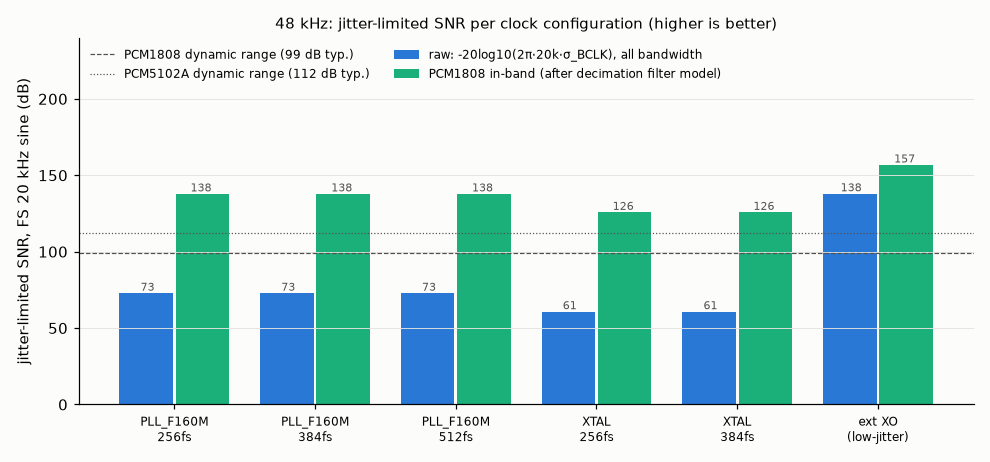

# TWOFOLD clock jitter analysis (ESP32-S3 I2S fractional MCLK divider)

Generated by `tools/clock_jitter.py` (do not edit by hand; re-run the script). Sine for the SNR figures: full scale, f0 = 20 kHz. Assumed PCM5102A PLL jitter transfer: 2nd-order low-pass, fc = 50 kHz (not published by TI). Sequence model: `nested` (see below).

## Summary (48 kHz, sources selectable in IDF 5.5.1)

| source | k | divider | MCLK pattern / lowest BCLK TIE line | BCLK TIE rms | raw SNR (BCLK) | ADC in-band | DAC full-band (PLL fc) |
|---|---|---|---|---|---|---|---|
| PLL_F160M | 256 | 13 + 1/48 | 256 / 256 kHz | 1.80 ns | 72.9 dB | 137.9 dB | 103.2 dB |
| PLL_F160M | 384 | 8 + 49/72 | 256 / 256 kHz | 1.80 ns | 72.9 dB | 137.9 dB | 103.2 dB |
| PLL_F160M | 512 | 6 + 49/96 | 256 / 256 kHz | 1.80 ns | 72.9 dB | 137.9 dB | 103.2 dB |
| XTAL | 256 | 3 + 49/192 | 64 / 64 kHz | 7.22 ns | 60.9 dB | 125.9 dB | 68.6 dB |
| XTAL | 384 | 2 + 49/288 | 64 / 64 kHz | 7.22 ns | 60.9 dB | 125.9 dB | 68.6 dB |

Low-jitter mode (external 12.288 MHz XO, 1 ps rms white): raw SNR 138.0 dB, PCM1808 in-band 156.9 dB; PCM5102A uses SCK = XO (no PLL), so its limit is the raw 138.0 dB.

## Check of PLAN.md §4.2

| PLAN row | divider | pattern | TIE step | % T_MCLK | verdict |
|---|---|---|---|---|---|
| PLL_F160M 256fs | 13 + 1/48 | 256 kHz | 6.25 ns | 7.7 % | matches |
| PLL_F160M 384fs | 8 + 49/72 | 256 kHz | 6.25 ns | 11.5 % | matches |
| PLL_F160M 512fs | 6 + 49/96 | 256 kHz | 6.25 ns | 15.4 % | matches |
| XTAL 256fs | 3 + 49/192 | 64 kHz | 25 ns | 30.7 % | matches |

All four rows of the PLAN table are reproduced (31 % is 30.7 % rounded). What the PLAN table does not show: the clock that matters for both converters' sampling instants is BCK/64·fs (PCM5102A PLL reference; PCM1808 modulator = SCKI/(k/64)), and its TIE is set only by the source clock period: 1.80 ns rms / 5.73 ns p-p with lines at n·256 kHz for **every** PLL_F160M multiple (256, 384 and 512 fs are identical at BCK level). The 256·fs choice is right (lowest MCLK frequency, smallest MCLK step, duty 46–54 %), but not because of a jitter advantage at BCK.

## Full table, 48 kHz

PLL_D2 (240 MHz) exists in hardware (TRM `I2S_TX_CLK_SEL = 1`) but IDF 5.5.1 does not offer it (`SOC_I2S_CLKS`); it is listed for reference only.

| source | k | MCLK (Hz) | IDF divider N + b/a | x / y / z / yn1 | bclk_div | MCLK error (ppm) | MCLK pattern rate | TIE step (1 src cycle) | MCLK period p-p | MCLK duty range | MCLK TIE p-p / rms | BCLK TIE p-p / rms (worst phase) | lowest BCLK TIE line | raw SNR @20k MCLK / BCLK | ADC in-band SNR (worst spur) | DAC full-band SNR no PLL / PLL fc | DAC in-band |
|---|---|---|---|---|---|---|---|---|---|---|---|---|---|---|---|---|---|
| PLL_F160M | 256 | 12,288,000 | 13 + 1/48 | 47 / 0 / 1 / 0 | 4 | +0.000 | 256 kHz | 6.25 ns (7.7 % T_MCLK) | 6.25 ns | 46.2–53.8 % | 6.12 / 1.80 ns | 5.73 / 1.80 ns | 256 kHz, 2012 ps | 72.9 / 72.9 dB | 137.9 dB (-143 dBc @ 4.0 kHz) | 72.9 / 103.2 dB | ∞ (none) |
| PLL_F160M | 384 | 18,432,000 | 8 + 49/72 | 2 / 3 / 23 / 1 | 6 | +0.000 | 256 kHz | 6.25 ns (11.5 % T_MCLK) | 6.25 ns | 44.4–55.6 % | 6.16 / 1.80 ns | 5.73 / 1.80 ns | 256 kHz, 2012 ps | 72.9 / 72.9 dB | 137.9 dB (-143 dBc @ 4.0 kHz) | 72.9 / 103.2 dB | ∞ (none) |
| PLL_F160M | 512 | 24,576,000 | 6 + 49/96 | 1 / 2 / 47 / 1 | 8 | +0.000 | 256 kHz | 6.25 ns (15.4 % T_MCLK) | 6.25 ns | 42.9–57.1 % | 6.18 / 1.80 ns | 5.73 / 1.80 ns | 256 kHz, 2012 ps | 72.9 / 72.9 dB | 137.9 dB (-143 dBc @ 4.0 kHz) | 72.9 / 103.2 dB | ∞ (none) |
| XTAL | 256 | 12,288,000 | 3 + 49/192 | 2 / 45 / 49 / 0 | 4 | +0.000 | 64 kHz | 25.00 ns (30.7 % T_MCLK) | 25.00 ns | 33.3–66.7 % | 24.87 / 7.22 ns | 24.48 / 7.22 ns | 64 kHz, 7963 ps | 60.8 / 60.9 dB | 125.9 dB (-131 dBc @ 4.0 kHz) | 60.9 / 68.6 dB | ∞ (none) |
| XTAL | 384 | 18,432,000 | 2 + 49/288 | 4 / 43 / 49 / 0 | 6 | +0.000 | 64 kHz | 25.00 ns (46.1 % T_MCLK) | 25.00 ns | 33.3–66.7 % | 24.91 / 7.22 ns | 24.48 / 7.22 ns | 64 kHz, 7963 ps | 60.8 / 60.9 dB | 125.9 dB (-131 dBc @ 4.0 kHz) | 60.9 / 68.6 dB | ∞ (none) |
| PLL_D2 | 256 | 12,288,000 | 19 + 17/32 | 1 / 2 / 15 / 1 | 4 | +0.000 | 384 kHz | 4.17 ns (5.1 % T_MCLK) | 4.17 ns | 47.4–52.6 % | 4.04 / 1.20 ns | 3.65 / 1.19 ns | 384 kHz, 1361 ps | 76.4 / 76.5 dB | 141.5 dB (-146 dBc @ 20.0 kHz) | 76.5 / 113.7 dB | ∞ (none) |
| PLL_D2 | 384 | 18,432,000 | 13 + 1/48 | 47 / 0 / 1 / 0 | 6 | +0.000 | 384 kHz | 4.17 ns (7.7 % T_MCLK) | 4.17 ns | 46.2–53.8 % | 4.08 / 1.20 ns | 3.65 / 1.19 ns | 384 kHz, 1361 ps | 76.4 / 76.5 dB | 141.5 dB (-146 dBc @ 20.0 kHz) | 76.5 / 113.7 dB | ∞ (none) |
| PLL_D2 | 512 | 24,576,000 | 9 + 49/64 | 3 / 4 / 15 / 1 | 8 | +0.000 | 384 kHz | 4.17 ns (10.2 % T_MCLK) | 4.17 ns | 44.4–55.6 % | 4.10 / 1.20 ns | 3.65 / 1.19 ns | 384 kHz, 1361 ps | 76.4 / 76.5 dB | 141.5 dB (-146 dBc @ 20.0 kHz) | 76.5 / 113.7 dB | ∞ (none) |

Rejected by the IDF driver (`i2s_std_calculate_clock()` requires sclk > 1.99·mclk, i.e. N ≥ 2): XTAL 512fs @ 48 kHz, XTAL 512fs @ 44.1 kHz.

## Reference: 44.1 kHz

| source | k | MCLK (Hz) | IDF divider N + b/a | x / y / z / yn1 | bclk_div | MCLK error (ppm) | MCLK pattern rate | TIE step (1 src cycle) | MCLK period p-p | MCLK duty range | MCLK TIE p-p / rms | BCLK TIE p-p / rms (worst phase) | lowest BCLK TIE line | raw SNR @20k MCLK / BCLK | ADC in-band SNR (worst spur) | DAC full-band SNR no PLL / PLL fc | DAC in-band |
|---|---|---|---|---|---|---|---|---|---|---|---|---|---|---|---|---|---|
| PLL_F160M | 256 | 11,289,600 | 14 + 76/441 | 4 / 61 / 76 / 0 | 4 | +0.000 | 25.6 kHz | 6.25 ns (7.1 % T_MCLK) | 6.25 ns | 46.7–53.3 % | 6.24 / 1.80 ns | 6.24 / 1.80 ns | 6.4 kHz, 21 ps | 72.9 / 72.9 dB | 105.6 dB (-107 dBc @ 5.6 kHz) | 72.9 / 99.8 dB | 105.7 |
| PLL_F160M | 384 | 16,934,400 | 9 + 13/29 | 1 / 3 / 13 / 0 | 6 | -5.517 | 584 kHz | 6.25 ns (10.6 % T_MCLK) | 6.25 ns | 44.4–55.6 % | 6.03 / 1.80 ns | 6.03 / 1.80 ns | 97.3 kHz, 218 ps | 72.9 / 72.9 dB | 137.9 dB (-143 dBc @ 18.0 kHz) | 72.9 / 103.8 dB | ∞ (none) |
| PLL_F160M | 512 | 22,579,200 | 7 + 38/441 | 10 / 23 / 38 / 0 | 8 | +0.000 | 51.2 kHz | 6.25 ns (14.1 % T_MCLK) | 6.25 ns | 42.9–57.1 % | 6.24 / 1.80 ns | 6.24 / 1.80 ns | 6.4 kHz, 21 ps | 72.9 / 72.9 dB | 105.6 dB (-107 dBc @ 5.6 kHz) | 72.9 / 99.8 dB | 105.7 |
| XTAL | 256 | 11,289,600 | 3 + 208/383 | 1 / 33 / 175 / 1 | 4 | +0.836 | 29.5 kHz | 25.00 ns (28.2 % T_MCLK) | 25.00 ns | 33.3–66.7 % | 24.93 / 7.22 ns | 24.93 / 7.22 ns | 7.37 kHz, 277 ps | 60.8 / 60.8 dB | 93.1 dB (-95 dBc @ 12.6 kHz) | 60.8 / 86.6 dB | 93.3 |
| XTAL | 384 | 16,934,400 | 2 + 21/58 | 1 / 16 / 21 / 0 | 6 | -5.517 | 292 kHz | 25.00 ns (42.3 % T_MCLK) | 25.00 ns | 33.3–66.7 % | 24.57 / 7.22 ns | 24.14 / 7.21 ns | 97.3 kHz, 1424 ps | 60.9 / 60.9 dB | 127.9 dB (-131 dBc @ 18.5 kHz) | 60.9 / 89.4 dB | ∞ (none) |

## Sensitivity to the (undocumented) edge ordering

BCLK TIE rms (ns) / ADC in-band SNR (dB) / DAC full-band SNR with PLL (dB), 48 kHz:

| source | k | nested | ideal | bunched |
|---|---|---|---|---|
| PLL_F160M | 256 | 1.80 / 137.9 / 103.2 | 1.80 / 137.9 / 103.2 | 1.80 / 137.9 / 103.2 |
| PLL_F160M | 384 | 1.80 / 137.9 / 103.2 | 1.80 / 137.9 / 103.2 | 1.80 / 137.9 / 103.2 |
| PLL_F160M | 512 | 1.80 / 137.9 / 103.2 | 1.80 / 137.9 / 103.2 | 1.80 / 137.9 / 103.2 |
| XTAL | 256 | 7.22 / 125.9 / 68.6 | 7.22 / 125.9 / 68.6 | 83.37 / 104.6 / 45.9 |
| XTAL | 384 | 7.22 / 125.9 / 68.6 | 7.22 / 125.9 / 68.6 | 53.64 / 108.4 / 50.2 |
| PLL_D2 | 256 | 1.19 / 141.5 / 113.7 | 1.19 / 141.5 / 113.7 | 1.19 / 141.5 / 113.7 |
| PLL_D2 | 384 | 1.19 / 141.5 / 113.7 | 1.19 / 141.5 / 113.7 | 1.19 / 141.5 / 113.7 |
| PLL_D2 | 512 | 1.19 / 141.5 / 113.7 | 1.19 / 141.5 / 113.7 | 1.19 / 141.5 / 113.7 |

## Model

* Divider values are computed by exact ports of `hal_utils_calc_clk_div_frac_accurate()` and `i2s_ll_tx_set_mclk()` (IDF v5.5.1); BCLK = MCLK / (mclk / (fs·2·32)) as in `i2s_std_calculate_clock()`.
* Over one pattern of `a` MCLK periods the divider emits `b` periods of N+1 and `a-b` of N source cycles. The TRM gives only the x/y/z/yn1 encoding, not the order. `nested` (default): z groups of x normal + 1 special period, the y leftovers spread by a second accumulator; `ideal`: first-order accumulator; `bunched`: leftovers at the end (worst case). For 13 + 1/48 all three are identical.
* TIE = actual rising-edge time minus ideal edge time, mean removed; spectrum = exact DFT over one pattern period (lines at multiples of the pattern fundamental). BCLK and the PCM1808 modulator clock (64 fs = SCKI/(k/64)) are every (k/64)-th MCLK edge; all divider phases are evaluated, the worst is reported.
* Raw SNR = −20·log10(2π·f0·σ): all jitter, full bandwidth. This is the classic random-jitter bound and is very pessimistic here: the jitter is deterministic and its lines sit at ≥ the pattern fundamental, so the error sidebands are at f_k ± f0, far outside the audio band.
* ADC in-band: sidebands (amplitude π·f0·A_k each) folded at 64 fs, passed by the decimation filter below 0.583 fs (conservatively unattenuated through the transition band) and attenuated 65 dB above (PCM1808 datasheet minimum), then aliased at fs; only components landing in 20 Hz–20 kHz count.
* DAC: the PCM5102A PLL locks to BCK. Full-band SNR is given unfiltered and through the assumed PLL low-pass. In-band counts only sidebands that land in 20 Hz–20 kHz in the analog output.
* Not modelled: random jitter of the PLL_F160M/XTAL source (unspecified by Espressif; `--src-rj-ps` adds it in quadrature), GPIO matrix/pad jitter, supply/ground-bounce coupling, and the second-order mechanism in delta-sigma DACs where out-of-band jitter mixes the shaped high-frequency quantisation noise down into the audio band (this is the main way 256 kHz jitter could still matter for the PCM5102A; it depends on its undocumented PLL and modulator).
* Self-consistency (run `--check`): the time-domain brute-force SNR (sine sampled at jittered instants) matches the formula to within 0.2 dB for every configuration.
