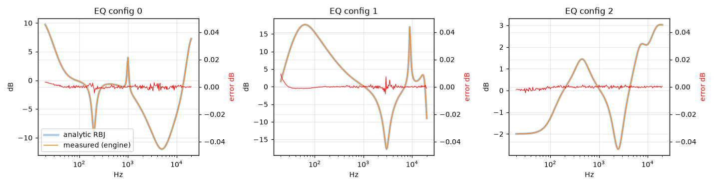
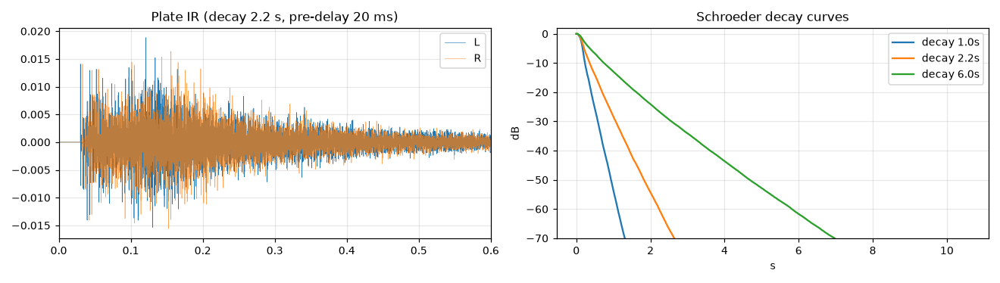
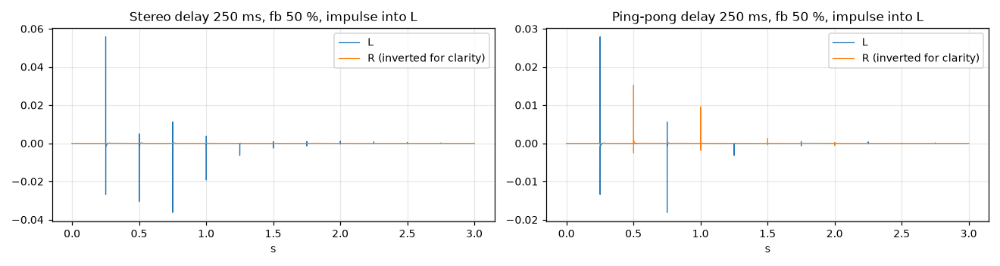
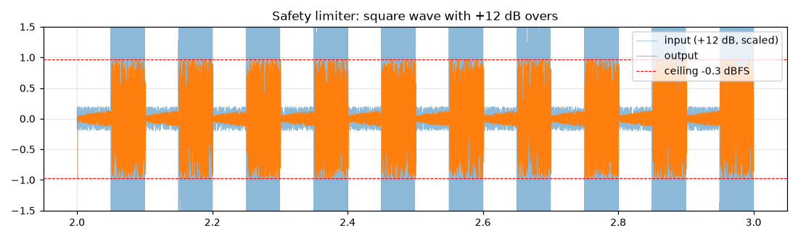
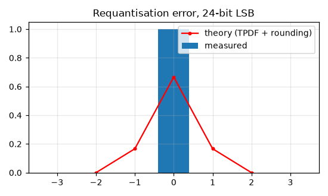
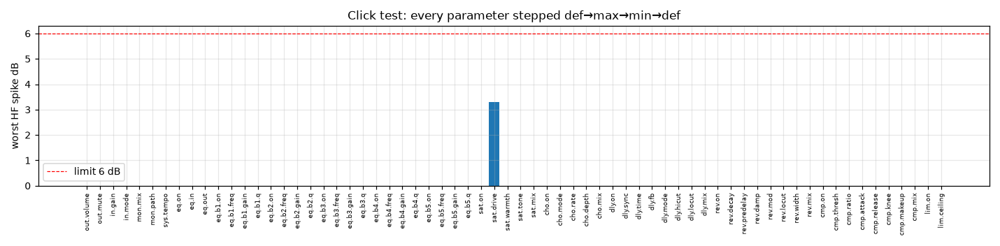

# DSP host test results

Generated by `host/dsp_tests/run.sh`. Every test drives the real engine (`firmware/components/dsp`) through its public API with the real parameter table.

| result | test |
|---|---|
| PASS | eq cfg0: max /measured - analytic RBJ/ = 0.0046 dB (at 206 Hz), limit 0.05 dB |
| PASS | eq cfg1: max /measured - analytic RBJ/ = 0.0093 dB (at 20 Hz), limit 0.05 dB |
| PASS | eq cfg2: max /measured - analytic RBJ/ = 0.0043 dB (at 31 Hz), limit 0.05 dB |
| PASS | limiter: peak out 0.966051 (-0.300 dBFS) with +12 dB overs, ceiling -0.30 dBFS |
| PASS | limiter below threshold: output bit-identical to limiter-off (lookahead 0 samples) |
| PASS | reverb decay 1.0 s: measured RT60 0.96 s (4.0 % off), L/R tail correlation -0.015, first output 30.1 ms (pre-delay 20 ms) |
| PASS | reverb decay 2.2 s: measured RT60 2.02 s (8.2 % off), L/R tail correlation -0.009, first output 30.1 ms (pre-delay 20 ms) |
| PASS | reverb decay 6.0 s: measured RT60 5.16 s (13.9 % off), L/R tail correlation -0.005, first output 30.1 ms (pre-delay 20 ms) |
| PASS | delay sync=FREE mode=STEREO: L@12052 L@24053, spacing 12001 (expect 12000), fixed engine latency 52 samples; successive same-side tap ratio -6.14 dB |
| PASS | delay sync=FREE mode=PING-PONG: L@12052 R@24053 L@36053, spacing 12001/12000 (expect 12000), fixed engine latency 52 samples; successive same-side tap ratio -11.89 dB |
| PASS | delay sync=1/4 mode=PING-PONG: L@24052 R@48053 L@72053, spacing 24001/24000 (expect 24000), fixed engine latency 52 samples; successive same-side tap ratio -11.89 dB |
| PASS | delay sync=1/8 D mode=STEREO: L@18052 L@36053, spacing 18001 (expect 18000), fixed engine latency 52 samples; successive same-side tap ratio -6.14 dB |
| PASS | saturation drive 12 dB, 5000 Hz -12 dBFS: worst alias -136.6 dBc (4x OS) vs -66.5 dBc naive tanh; in-band THD -24.7 dB |
| PASS | saturation drive 12 dB, 9000 Hz -12 dBFS: worst alias -139.2 dBc (4x OS) vs -45.1 dBc naive tanh; in-band THD -31.5 dB |
| PASS | saturation drive 6 dB, 9000 Hz -6 dBFS: worst alias -143.3 dBc (4x OS) vs -45.1 dBc naive tanh; in-band THD -31.5 dB |
| INFO | saturation EXTREME corner (informational): drive 24 dB, 9000 Hz -6 dBFS: worst alias -47.3 dBc (4x OS) vs -17.6 dBc naive tanh |
| INFO | saturation EXTREME corner (informational): drive 24 dB, 13000 Hz -6 dBFS: worst alias -32.7 dBc (4x OS) vs -10.0 dBc naive tanh |
| PASS | TPDF dither (aligned for 52-sample latency): error mean 0.0002 LSB, rms 0.526 LSB (theory 0.500), L/R correlation 0.0015, /e/ <= 2 LSB: yes |
| PASS | record path at unity gain (STEREO): 0 mismatching samples of 96000 (bit-exact) |
| PASS | DAC path at unity, flat chain, 24-bit input: error rms 0 LSB over 383896 samples (bit-perfect) |
| PASS | click test: 78 parameters stepped def->max->min->def under a 1 kHz+100 Hz tone; worst 1 ms HF spike 3.29 dB over its neighbourhood (sat.drive, max->min), limit 6 dB |
| PASS | preset crossfades: worst 1 ms HF spike 0.0 dB over its +-10 ms neighbourhood (limit 6 dB); soft mute 0.0 dB, reaches digital silence: yes |
| PASS | host benchmark (x86, informational): full chain incl. all effects runs 70x realtime (298 ns/frame) |

## Host stage breakdown (x86, relative share of engine time, all effects on)

| stage | % of engine time |
|---|---|
| INPUT | 3.0 |
| EQ | 1.1 |
| SAT | 39.2 |
| CHORUS | 15.1 |
| DELAY | 5.2 |
| REVERB | 16.2 |
| COMP | 9.3 |
| OUTPUT | 2.4 |
| DITHER | 8.5 |

## Plots

